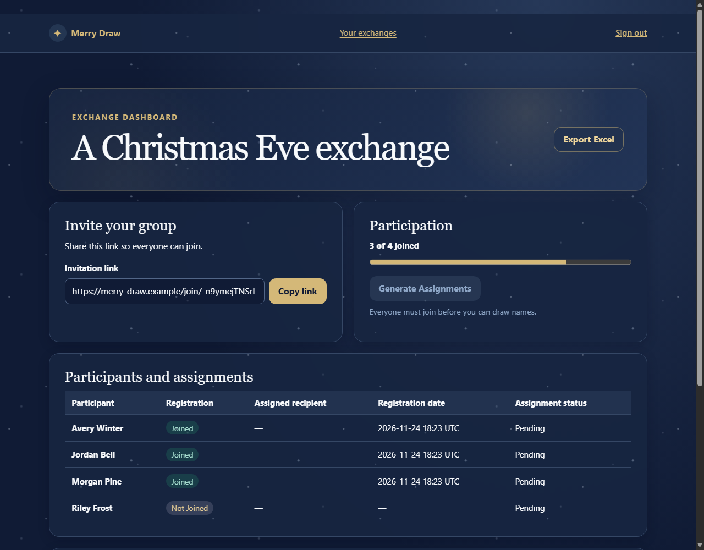
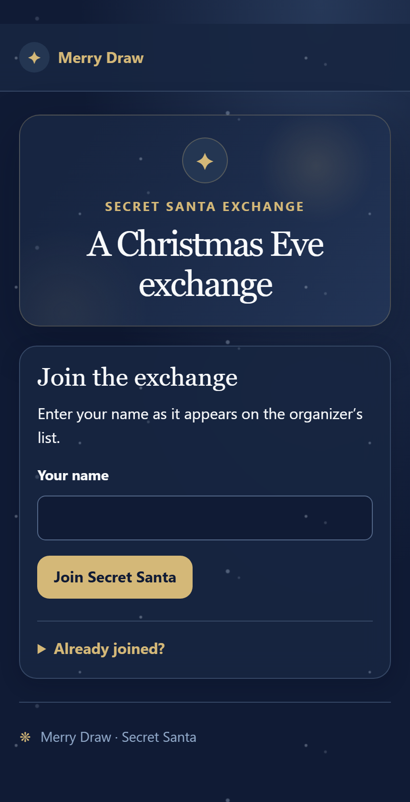

# Merry Draw

Merry Draw is a Secret Santa website with a navy-and-gold Christmas theme. An organizer creates an exchange, shares one public invitation, and draws names once the full roster has joined. Each guest reveals their own recipient in a private view.

## Screenshots





## How an exchange works

1. Sign in at `/admin`, create an event, and enter 2–500 distinct names, one per line. Use distinct display names for guests who share a name.
2. Copy the invitation from the dashboard and share it with the group. A guest claims their roster entry by entering their name. The first claim assumes people in the group enter their own names, so share the invitation only with the intended guests.
3. Each guest should save their private link or access code. The browser also remembers their access on that device. To return on a different device, open the private link or enter the code under **Already joined?**. Keep the code confidential. Organizer access to the dashboard does not recover a lost private code.
4. After everyone joins, click **Generate Assignments**. The draw samples a complete random permutation with no self-pairings. The database enforces unique givers and recipients, and the application saves the draw in a single transaction.
5. Guests return to reveal their recipient. The organizer can see registrations, assignments, and activity, and download the three Excel sheets from the dashboard.

## Run locally

Install Python 3.12 or later and clone the repository.

```sh
git clone https://github.com/Habiba14adell/secret_santa.git
cd secret_santa
python -m venv .venv
```

Activate the virtual environment with `.venv\Scripts\Activate.ps1` in PowerShell or `source .venv/bin/activate` on macOS/Linux. If PowerShell blocks activation, run the commands below with `.venv\Scripts\python.exe` in place of `python`.

```sh
python -m pip install -r requirements.txt
python -c "import secrets; print(secrets.token_urlsafe(48))"
python admin_password.py
```

Copy `.env.example` to `.env`. Paste the random secret and generated password hash into their single-quoted fields. Leave `SANTA_SECURE_COOKIES=0` for local HTTP. Keep the password and the `.env` file outside Git.

```sh
python -m flask --app santa migrate
python -m flask --app santa run
```

Open [the local organizer dashboard](http://127.0.0.1:5000/admin) and sign in with the password you chose. A local invitation is only reachable on your own computer. Deploy the site before sharing an invitation with a remote group.

## Configuration

| Variable | Local development | Production |
| --- | --- | --- |
| `SANTA_SECRET_KEY` | Random secret of at least 32 characters | Keep stable across restarts. Render generates it. |
| `SANTA_ADMIN_PASSWORD_HASH` | Output of `python admin_password.py` | Supply the hash as a secret environment variable. Use a strong unique password. |
| `SANTA_SECURE_COOKIES` | `0` for HTTP | `1` for HTTPS. This is the default. |
| `DATABASE_URL` | Omit for SQLite, or use a PostgreSQL URL. | Set to a persistent PostgreSQL connection string. The Blueprint wires the internal URL. |
| `SANTA_DATABASE` | Optional SQLite path. Defaults to `instance/santa.sqlite3`. | Unused with PostgreSQL. |
| `SANTA_PUBLIC_BASE_URL` | Omit to use the current origin. | HTTPS origin for invitation links. Render's external URL is used by default. |
| `SANTA_TRUSTED_HOSTS` | Comma-separated hostnames. Defaults to `localhost,127.0.0.1`. | Add any additional served hostnames. The public origin's host is allowed automatically. |
| `PORT` | Waitress defaults to `8000`. | The platform supplies the listener port. |

## Database and migrations

The app applies pending, versioned migrations on startup. Run `python -m flask --app santa migrate` to apply them explicitly against the configured database. The migration ledger resides in `schema_migrations`. Append new migrations in `santa/db.py` without editing versions already applied. Back up production data before changing the schema and test upgrades against a separate database.

SQLite stores local development data on disk. PostgreSQL stores production data independently of the web service and survives redeploys. Starting with a fresh PostgreSQL database creates an empty production roster. The migration command creates or upgrades the schema and leaves development data in its original SQLite database.

## Deploy to Render

1. Push the source to GitHub and connect the repository from **New → Blueprint** in Render. The included `render.yaml` provisions a Python web service and a managed PostgreSQL database using paid plans. Review the prices in Render before creating the resources. [Render Blueprint documentation](https://render.com/docs/infrastructure-as-code)
2. When prompted, supply `SANTA_ADMIN_PASSWORD_HASH` from the password helper. Render generates `SANTA_SECRET_KEY`, injects the internal `DATABASE_URL`, and enables secure cookies. For a custom domain, set `SANTA_PUBLIC_BASE_URL` to its HTTPS origin and include additional served names in `SANTA_TRUSTED_HOSTS`. [Blueprint environment settings](https://render.com/docs/blueprint-spec)
3. Render installs dependencies with `pip install -r requirements.txt` and starts Waitress with `python serve.py`. Startup initializes the database. The `/healthz` endpoint checks database connectivity. Configure login rate limiting at the edge if your deployment uses a reverse proxy or WAF.
4. After deployment, open `/healthz` over HTTPS and verify it returns `ok`. Open `/admin` in a signed-out browser and verify it redirects to sign-in. Create a test exchange with two distinct guests, copy its public link, and open it from an independent browser or device. Join as both guests, draw names, check that each guest sees their own recipient, and export the workbook. Redeploy and verify that the same private links still reveal the same recipients.

## Tests and layout

```sh
python -m unittest discover -s tests -v
```

Tests use temporary SQLite files by default. Set `TEST_DATABASE_URL` to run the same suite on a dedicated PostgreSQL test database. The test account needs permission to create and drop the isolated schemas created by the suite.

- `santa/views.py` contains the private organizer routes and the public invitation flow.
- `santa/service.py` contains validation, registration, the draw, and activity.
- `santa/db.py` contains SQLite and PostgreSQL access, transactions, and migrations.
- `santa/export.py` builds the workbook with Pandas and OpenPyXL.
- `santa/templates/` and `santa/static/` contain the responsive interface.
- `tests/test_flow.py` covers duplicate registration, draw rules, restored access, privacy, and Excel export.
